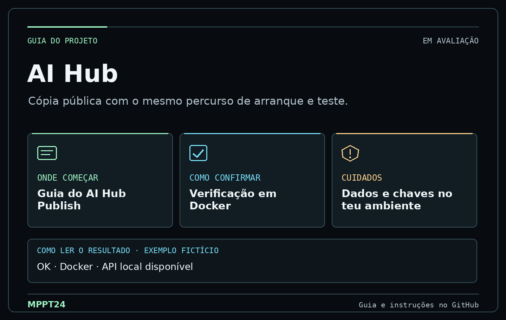

# Guia de AI Hub

**Estado:** Em avaliação.

Cópia pública com o mesmo percurso de arranque e teste.

[](docs/guia-visual.png)

## Onde começar

Consulta o [guia de teste local](https://github.com/mppt24/ai-hub-publish#testar-a-api-localmente).

## Como confirmar

Para verificar esta cópia, executa o seu teste de saúde e abre a execução de Docker em **Actions**.

## Como ler os registos

Os registos do contentor ajudam a separar um erro de arranque de um erro ao ligar ao modelo. A CI desta cópia confirma o primeiro percurso.

### Exemplo fictício

```text
OK · Docker · API local disponível
```

Lê pela ordem **resultado**, **etapa** e **detalhe**. Para investigar uma falha, confirma primeiro a data e a versão, depois abre o primeiro passo que falhou.

## Cuidados

Usa a configuração local do guia. Não incluas chaves, ficheiros de configuração privados ou mensagens reais nos exemplos.
